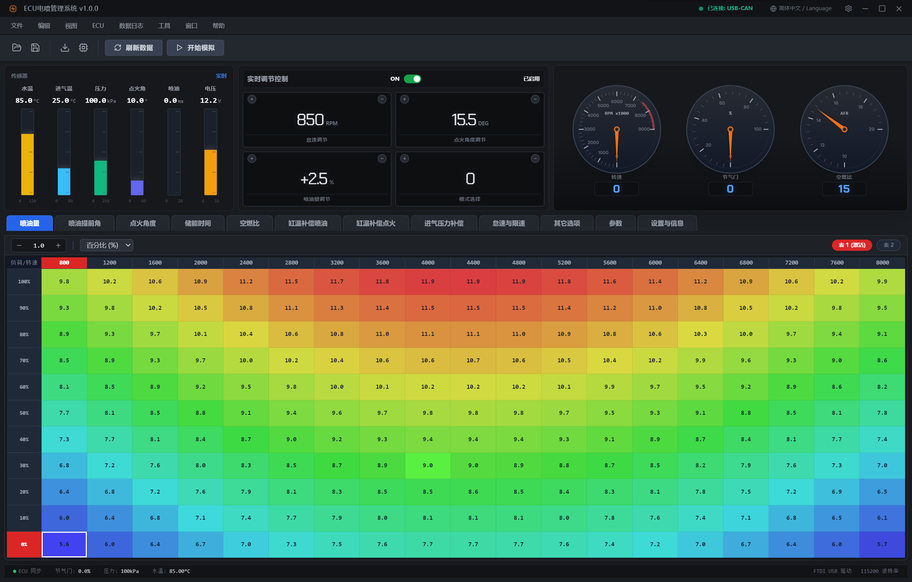

> **关于本项目**：这是我参与的一个 2 人同学团队兼职商用项目（ECU 电调校软件）。
> 我负责**前端与交互层**：全部 UI 界面设计与实现、仪表盘屏幕适配、参数表格编辑、
> 本地数据加密、Electron 通信层对接，以及 mock ECU 模拟器的实现与串口联调测试；
> 通信层架构设计与后端中继服务由队友完成。
> 本仓库为个人存档版本，用于展示我负责的部分。

<div align="center">
  
  
  # ECU电喷管理系统
  
  [](https://github.com/g1908664405/ecu-x-client)
  [](LICENSE)
  [](https://www.electronjs.org/)
  [](https://reactjs.org/)
  
  专业的发动机控制单元（ECU）调校与监控系统
  
  [English](./README_EN.md) | 简体中文
</div>

## 📖 简介

ECU电喷管理系统是一款高保真桌面应用程序，专为发动机控制单元（ECU）的调校和实时监控而设计。提供直观的数据可视化、交互式地图编辑和传感器校准功能。

### ✨ 主要特性

- 🎯 **实时监控** - 仪表盘显示转速、节气门、空燃比等实时数据
- 📊 **调校地图** - 2D/3D交互式燃油、点火地图编辑
- 🔧 **传感器校准** - 支持温度、压力、TPS等传感器校准
- 🌐 **多语言支持** - 支持简中、繁中、英语、日语、泰语、韩语、俄语、德语、法语
- 🎨 **深色主题** - 工业风格暗色界面，适合长时间使用
- 📡 **USB-CAN通信** - 支持硬件连接或模拟器测试
- 🎮 **内置模拟器** - 无需硬件即可测试UI响应

## 🖼️ 界面预览

<div align="center">
  
</div>

## 🛠️ 技术栈

- **运行时**: Electron 28.0
- **前端框架**: React 18 + TypeScript
- **构建工具**: Vite 5.0
- **样式**: Tailwind CSS + 自定义主题
- **图标**: Lucide React
- **国际化**: 自定义 i18n 系统

## 📦 安装与运行

### 前置要求

- Node.js >= 16.0
- npm 或 pnpm

### 开发环境

```bash
# 克隆项目
git clone https://github.com/g1908664405/ecu-x-client.git
cd ecu-x-client

# 安装依赖
npm install
# 或使用 pnpm
pnpm install

# 启动开发服务器
npm run dev
```

### 构建项目

```bash
# 编译生产版本
npm run build

# 启动应用
npm start
```

## 📦 打包发布

支持跨平台打包，详见 [BUILD.md](./BUILD.md)

```bash
# 安装打包工具
npm install

# 打包 Windows
npm run dist:win

# 打包 macOS
npm run dist:mac

# 打包 Linux
npm run dist:linux

# 打包所有平台
npm run dist:all
```

打包后的文件在 `release/` 目录下。

## 🎨 主题系统

项目使用统一的主题系统，位于 `src/theme.css`：

- CSS 变量定义（`--bg-panel`, `--text-primary` 等）
- 预定义主题类（`theme-bg-panel`, `theme-text-primary` 等）
- 通用组件样式（表格、按钮、面板等）

**使用示例**：

```tsx
<div className="theme-bg-panel theme-text-primary">
  内容
</div>
```

## 📁 项目结构

```
ecu-x-client/
├── electron/          # Electron 主进程
├── src/               # 源代码
│   ├── components/    # React 组件
│   │   └── common/    # 通用组件 (ToggleSwitch 等)
│   ├── i18n/          # 国际化翻译文件
│   ├── App.tsx        # 主应用
│   ├── theme.css      # 主题样式
│   ├── types.ts       # TypeScript 类型定义
│   └── version.ts     # 版本配置
├── UI/                # 设计资源和参考图
├── assets/            # 静态资源
├── build/             # 打包图标目录
└── dist/              # 构建输出
```

## 🌍 国际化

支持 9 种语言，翻译文件位于 `src/i18n/locales/`：

- 🇨🇳 简体中文 (zh-CN)
- 🇹🇼 繁体中文 (zh-TW)
- 🇺🇸 English (en)
- 🇯🇵 日本語 (ja)
- 🇹🇭 ไทย (th)
- 🇰🇷 한국어 (ko)
- 🇷🇺 Русский (ru)
- 🇩🇪 Deutsch (de)
- 🇫🇷 Français (fr)

## 🤝 贡献指南

欢迎提交 Issue 和 Pull Request！

1. Fork 本仓库
2. 创建特性分支 (`git checkout -b feature/AmazingFeature`)
3. 提交更改 (`git commit -m 'Add some AmazingFeature'`)
4. 推送到分支 (`git push origin feature/AmazingFeature`)
5. 开启 Pull Request

## 📄 开源协议

本项目采用 [MIT](LICENSE) 协议开源。

## 👥 贡献者

感谢所有为本项目做出贡献的开发者！

## 📞 联系方式

- **项目主页**: https://github.com/g1908664405/ecu-x-client
- **问题反馈**: https://github.com/g1908664405/ecu-x-client/issues

## 🙏 致谢

感谢以下开源项目：

- [Electron](https://www.electronjs.org/)
- [React](https://reactjs.org/)
- [Vite](https://vitejs.dev/)
- [Tailwind CSS](https://tailwindcss.com/)
- [Lucide Icons](https://lucide.dev/)

---

<div align="center">
  Made with ❤️ by ECU Team
</div>
