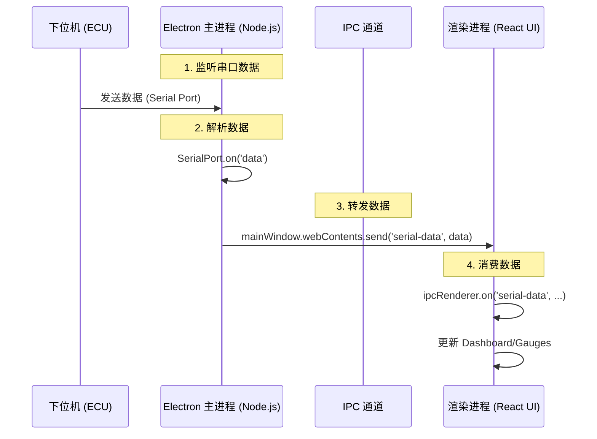
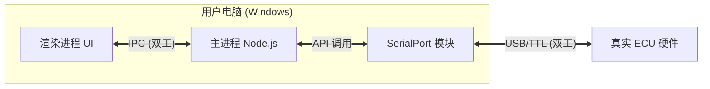
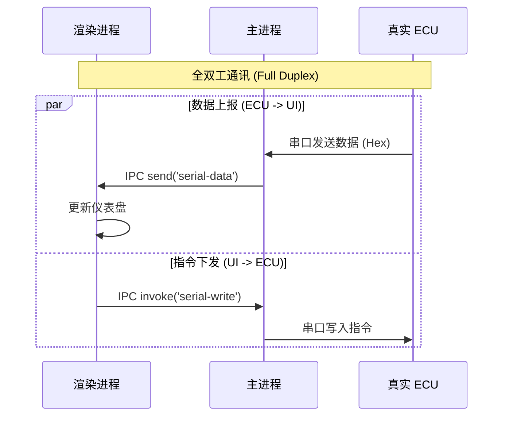
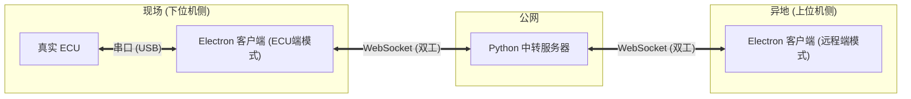
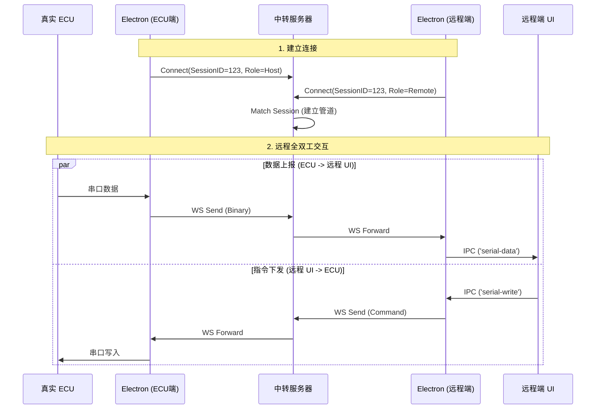

# 串口通讯与远程联调概要设计文档 (HLD)

**版本**: 1.0.0  
**日期**: 2025-12-20  
**状态**: 拟定中

---

## 1. Electron 进程模型与通讯机制

### 1.1 进程模型概述
Electron 应用主要由两个类型的进程组成：

1.  **主进程 (Main Process)**:
    *   运行 Node.js 环境，拥有完整的操作系统访问权限。
    *   负责管理应用生命周期、创建窗口、以及**硬件交互（如串口通信）**。
    *   在本项目中，`electron/main.js` 是主进程入口。

2.  **渲染进程 (Renderer Process)**:
    *   运行 Chromium 浏览器环境，负责 UI 展示（React/HTML/CSS）。
    *   出于安全考虑，通常不直接访问硬件或 Node.js API。
    *   在本项目中，`src/App.tsx` 及其组件运行在此进程。

### 1.2 当前项目的串口信号传递流程
目前项目中，串口数据从下位机到达 UI 的路径如下：



---

## 2. 现有代码分析与风险识别

基于 `electron/main.js` 的代码审查，识别出以下问题：

### 2.1 安全性风险 (高)
*   **现状**: `webPreferences: { nodeIntegration: true, contextIsolation: false }`
*   **问题**: 这赋予了渲染进程直接调用 Node.js 的权限。如果加载了恶意代码或第三方库被入侵，攻击者可以直接操作用户文件系统。
*   **建议**: 启用 `contextIsolation: true`，使用 `preload.js` 和 `contextBridge` 暴露受限的 API。

### 2.2 数据协议风险 (中)
*   **现状**: 使用了 `ReadlineParser({ delimiter: '\r\n' })`。
*   **问题**: 
    *   **二进制兼容性**: ECU 通常传输二进制数据（Hex），而非纯文本。如果数据中偶然包含 `0x0D 0x0A` (\r\n)，数据会被错误截断。
    *   **丢包/粘包**: 简单的行解析无法处理复杂的粘包情况。
*   **建议**: 移除 `ReadlineParser`，在主进程接收原始 `Buffer`，根据自定义协议（如：帧头+长度+Payload+校验和）进行封包，再发送给渲染进程。

### 2.3 架构耦合 (低)
*   **现状**: 串口逻辑直接写在 `createWindow` 和 IPC 处理函数中。
*   **建议**: 封装 `SerialService` 类，专门处理连接状态和数据流。

---

## 3. 通讯模式详细设计

系统提供两种互斥的通讯模式，用户可在"连接设置"中进行切换。

### 3.1 模式切换与用户旅程

用户打开应用后，进入"连接/设置"页面，顶部提供模式切换开关：
*   **本地直连 (默认)**: 适用于现场调试，PC 直接连接 ECU。
*   **远程联调**: 适用于异地协作，通过网络中转数据。

### 3.2 本地直连模式 (Local Direct Mode)

#### 3.2.1 场景描述
这是最基础的使用场景。操作人员携带安装了本软件的笔记本电脑，通过 USB 转串口线直接物理连接到 ECU。

#### 3.2.2 系统架构图 (本地)



#### 3.2.3 通讯流程图 (本地)



#### 3.2.4 UI 原型 (本地)

```text
+--------------------------------------------------+
|  连接设置                                        |
+--------------------------------------------------+
|  [ 本地直连 ]  [ 远程联调 ]                      |
|                                                  |
|  串口设置:                                       |
|  端口:   [ COM3 (USB-SERIAL) v]                  |
|  波特率: [ 115200            v]                  |
|  数据位: [ 8 v]  停止位: [ 1 v]  校验: [ None v] |
|                                                  |
|  [ 打开串口 ]                                    |
|                                                  |
|  状态: 已连接 (COM3, 115200)                     |
+--------------------------------------------------+
```

### 3.3 远程联调模式 (Remote Debugging Mode)

#### 3.3.1 场景描述
当研发专家不在现场时使用。
*   **现场人员**使用"ECU 端模式"，将电脑连接 ECU 并接入互联网。
*   **研发专家**使用"远程端模式"，在异地通过互联网连接同一会话。
*   双方建立**全双工**通道，研发专家如同在现场一样操作。

#### 3.3.2 系统架构图 (远程)



#### 3.3.3 通讯流程图 (远程)



#### 3.3.4 UI 原型 (远程)

```text
+--------------------------------------------------+
|  连接设置                                        |
+--------------------------------------------------+
|  [ 本地直连 ]  [ 远程联调 ]                      |
|                                                  |
|  角色选择:                                       |
|  (o) 我是现场人员 (连接 ECU)                     |
|  ( ) 我是远程专家 (调试端)                       |
|                                                  |
|  ----------------------------------------------  |
|  [现场人员配置区]                                |
|  1. 本地串口: [ COM3 v] [ 115200 v]              |
|  2. 服务器:   [ 1.2.3.4:8765       ]             |
|  3. 会话 ID:  [ 123456             ]             |
|                                                  |
|  [ 启动服务 ] (同时连接串口和网络)               |
|  ----------------------------------------------  |
|                                                  |
|  状态日志:                                       |
|  > [Host] Serial Connected.                      |
|  > [Network] Waiting for remote peer...          |
|  > [System] Remote peer joined! Duplex ready.    |
+--------------------------------------------------+
```

---

## 4. 协议转换与数据封装

在远程联调模式下，为了保证数据完整性，建议在 TCP 层之上做一层简单的封装（可选，视网络稳定性而定）。

### 4.1 纯透传模式 (当前推荐)
*   **机制**: TCP 流直接承载串口字节流。
*   **优点**: 实现简单，Python 脚本只需几行代码。
*   **缺点**: 如果网络波动导致 TCP 分包，主进程需要有能力处理半包数据（这本身也是串口处理必须具备的能力）。

### 4.2 抽象层接口设计 (TypeScript)

主进程应定义统一接口，屏蔽底层差异：

```typescript
// 抽象数据源接口
interface IDataSource {
  connect(config: any): Promise<void>;
  disconnect(): Promise<void>;
  write(data: Buffer): Promise<void>;
  on(event: 'data', listener: (data: Buffer) => void): void;
  on(event: 'error', listener: (err: Error) => void): void;
}

// 串口实现
class SerialDataSource implements IDataSource {
  // 封装 serialport 库
}

// 网络实现 (远程联调)
class NetworkDataSource implements IDataSource {
  // 封装 net.Socket
}
```

## 5. 实施步骤

1.  **重构主进程**: 创建 `CommunicationManager` 类，支持策略模式切换数据源。
2.  **开发 Python 脚本**:
    *   `relay_server.py`: 基于 `websockets` 的中转服务。
3.  **UI 更新**: 在连接设置页增加 "连接类型" 下拉框 (Serial / Remote WebSocket)。

## 6. 附录：中转服务器伪代码 (Python/WebSocket)

```python
import asyncio
import websockets
import json

# 会话存储: { sessionId: { 'host': websocket, 'remote': websocket } }
sessions = {}

async def handler(websocket):
    # 1. 握手阶段 (Handshake)
    # 客户端发送: {"sessionId": "123", "role": "host" | "remote"}
    try:
        init_msg = await websocket.recv()
        data = json.loads(init_msg)
        session_id = data['sessionId']
        role = data['role']
    except:
        return # 握手失败

    # 2. 注册连接
    if session_id not in sessions:
        sessions[session_id] = {}
    
    # 如果该角色已存在，关闭旧连接
    if role in sessions[session_id]:
        await sessions[session_id][role].close()
        
    sessions[session_id][role] = websocket
    print(f"Session {session_id}: {role} connected")

    # 3. 状态通知 (可选)
    peer_role = 'remote' if role == 'host' else 'host'
    peer_ws = sessions[session_id].get(peer_role)
    
    if peer_ws:
        # 通知双方对方已上线
        await peer_ws.send(json.dumps({"type": "sys", "msg": f"{role} joined"}))
        await websocket.send(json.dumps({"type": "sys", "msg": f"{peer_role} joined"}))

    # 4. 转发循环 (Relay Loop)
    try:
        async for message in websocket:
            # 检查对端是否在线
            peer_ws = sessions[session_id].get(peer_role)
            if peer_ws:
                # 直接透传数据 (Binary or Text)
                await peer_ws.send(message)
    except:
        pass
    finally:
        # 5. 清理连接
        if session_id in sessions and sessions[session_id].get(role) == websocket:
            del sessions[session_id][role]
            
        # 通知对端下线
        peer_ws = sessions[session_id].get(peer_role)
        if peer_ws:
             await peer_ws.send(json.dumps({"type": "sys", "msg": f"{role} disconnected"}))
        
        # 如果会话为空，清理会话
        if session_id in sessions and not sessions[session_id]:
            del sessions[session_id]

async def main():
    async with websockets.serve(handler, "0.0.0.0", 8765):
        print("Relay Server started on port 8765")
        await asyncio.Future()  # run forever

if __name__ == "__main__":
    asyncio.run(main())
```
